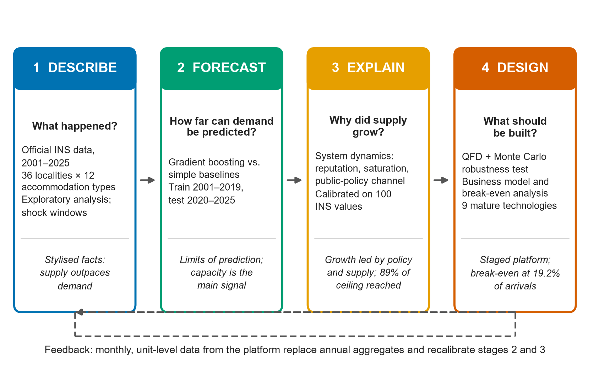

# From Data to Decision: Digital Technologies in a Rural Agritourism Destination (Gorj County, Romania)

This repository accompanies the article

> **From Data to Decision: A Forecasting, System Dynamics and QFD Framework for Digital Technologies in a Rural Agritourism Destination (Gorj County, Romania)**
>
> Loredana Elena Stancioiu, Andreea Cristina Ionica and Monica Leba
>
> Submitted to the Special Issue **“Rural Tourism, Nature-Based Tourism and Sustainable Tourism Practices”** of the journal ***Sustainability*** (MDPI).

It contains the data, the Python code, the results, the figures and the interactive tools used in the article. The manuscript itself is not included.

## The four stages

| Stage | Question | Method | Folder | Article |
|---|---|---|---|---|
| 1. Describe | How did supply, demand and occupancy evolve? | Panel checks, indicators, shock windows | [`stage1_describe/`](stage1_describe) | §3.2–3.3, 4.1; Tables 2–3 |
| 2. Forecast | How accurately can overnight stays be forecast? | Stochastic gradient boosting against five baselines | [`stage2_forecast/`](stage2_forecast) | §3.4, 4.2; Table 4 |
| 3. Explain | Why did supply grow, and what if conditions had differed? | System dynamics: calibration, scenarios, sensitivity | [`stage3_system_dynamics/`](stage3_system_dynamics) | §3.5, 4.3, 5.3; Table 5 |
| 4. Design | What should the platform do, and is it viable? | QFD, Monte Carlo, financial model, Business Model Canvas | [`stage4_design/`](stage4_design) | §3.6–3.7, 4.4–4.5; Tables 6–8 |



## Interactive tools

Self-contained HTML files with no external dependencies. Download a file and open it in a browser.

| File | Content |
|---|---|
| [`simulator_model1_capacity.html`](stage3_system_dynamics/simulators/simulator_model1_capacity.html) | Model 1: hotel and agritourism capacity, with policy scenarios |
| [`simulator_model2_quality_of_life.html`](stage3_system_dynamics/simulators/simulator_model2_quality_of_life.html) | Model 2 (exploratory): residents' acceptance of technologies and quality of life |
| [`business_model_canvas.html`](stage4_design/business_model_canvas.html) | Editable Business Model Canvas with the financial model and break-even analysis |

## Quick start

Python 3.10 or newer (tested with Python 3.12).

```bash
pip install -r requirements.txt
python run_all.py
```

`run_all.py` rebuilds the processed data, all results, the simulators, the canvas and the figures, and then compares the numbers of the article with the computed ones. Every script can also be run on its own from the repository root.

The calibration of Model 1 is not part of `run_all.py` (the calibrated parameters are stored in `sd1_model.py`). To repeat it:

```bash
python stage3_system_dynamics/sd1_calibrate.py 1 30000 --wide
python stage3_system_dynamics/sd1_calibrate.py 1 30000 --wide --occupancy-term
python stage3_system_dynamics/sd1_calibrate.py 1 30000 --wide --no-shocks
python stage3_system_dynamics/sd1_profile.py
```

With seeds 1, 2 and 3 the base calibration converges to the same weighted log-error (30.149). Adding the occupancy term leaves the error unchanged (its coefficient goes to zero). The stored outputs of these runs are in `stage3_system_dynamics/results/calibration_*.json`.

## Repository structure

```
common/                    paths and loading of the official statistics
data/                      raw INS files, processed CSV files, data dictionary
stage1_describe/           descriptive analysis
stage2_forecast/           CART and gradient boosting (NumPy only), baselines, diagnostics
stage3_system_dynamics/    Model 1, Model 2, calibration, simulators
stage4_design/             QFD, financial model, Business Model Canvas
figures/                   Figures 1-5 and the script that draws them
run_all.py
```

### Other remarks

* The financial model uses 58,870 agritourism overnight stays for 2025, derived from the rounded share (27.5% of 214,072). The exact value of the series is 58,972.
* The QFD matrices, evidence scores and implementation effort are the authors' judgements. The prices, commission, subscription, number of guesthouses and costs in the financial model are assumptions.
* Model 2 is a scenario model with assumed parameters; its numbers should not be read as forecasts.

## Data

The statistics are public data of the National Institute of Statistics of Romania (INS, TEMPO-Online and the TUR1A survey), obtained for 2001–2025 through the Gorj County Statistics Directorate. File names and contents are kept as received (in Romanian); personal names were removed from the metadata of the spreadsheet files. See [`data/README.md`](data/README.md). Please cite INS as the source when reusing the data.

## License

Released under the [MIT License](LICENSE). The license covers the code and documentation written by the authors; the official statistics in `data/` remain subject to the terms of use of their publisher.

## Citation

Please cite the article (details will be added after publication) and, if useful, this repository ([`CITATION.cff`](CITATION.cff)).
